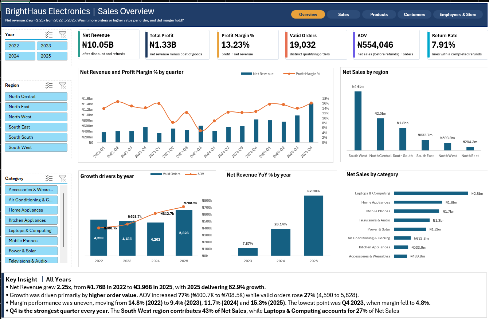
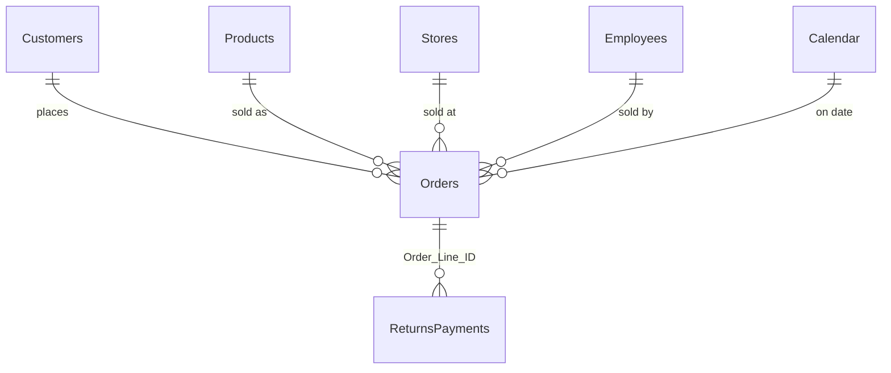
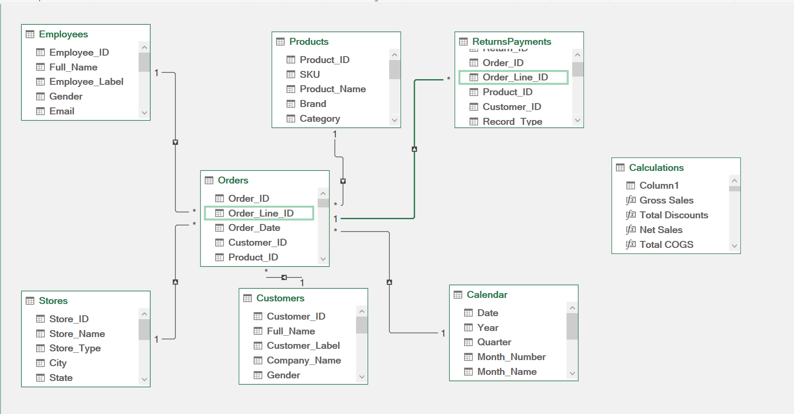
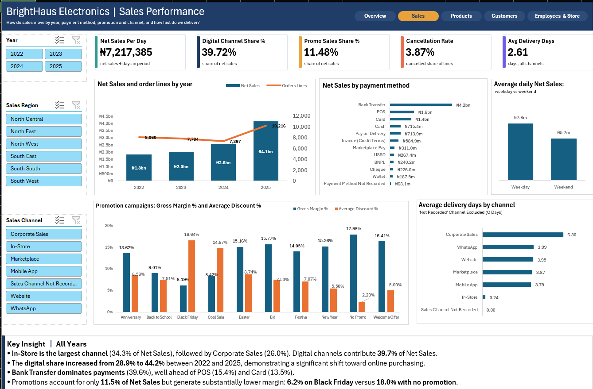
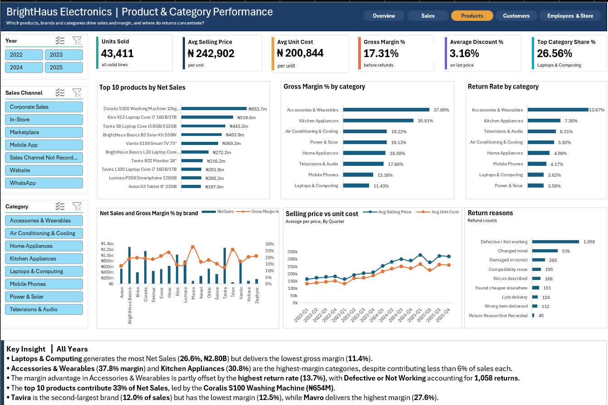
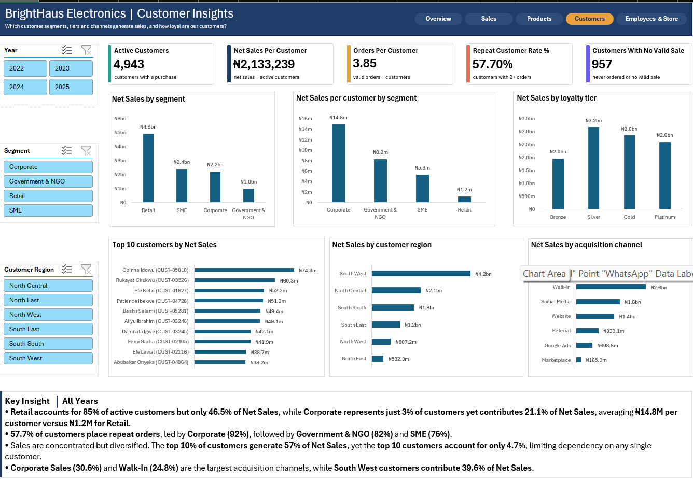
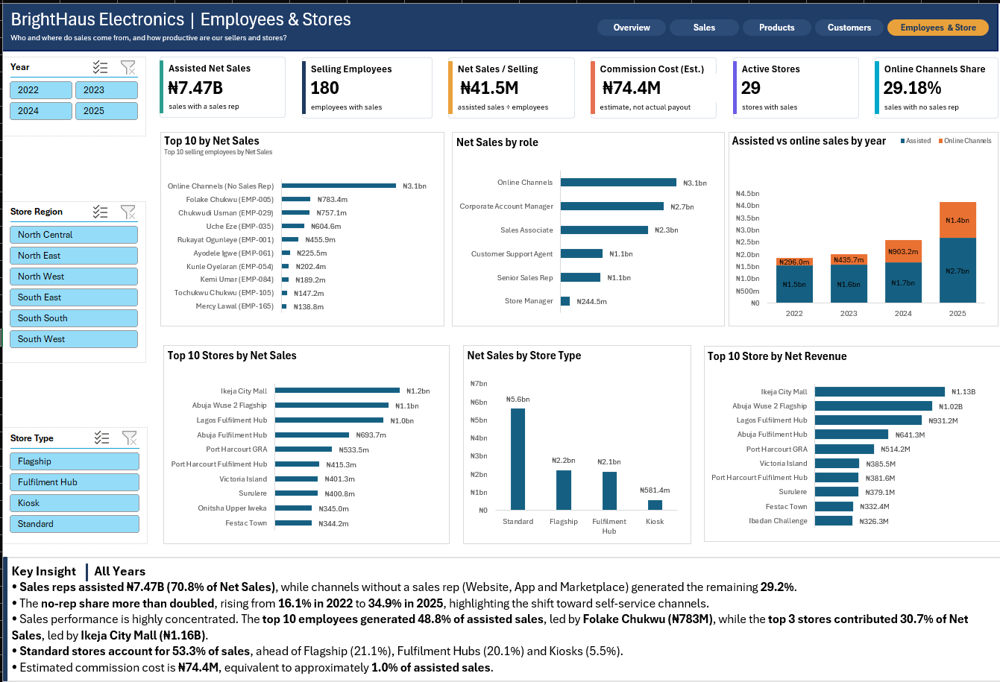

# BrightHaus Electronics: Sales, Profitability and Returns Analytics

**An Excel project built from raw, multi-table retail data: data quality investigation, Power Query cleaning, a star-schema Data Model, DAX measures and a five-page interactive dashboard.**


I took seven raw tables from five source systems (about 33,700 order lines) and turned them into a clean, validated data model and an interactive dashboard for a  Nigerian electronics retailer. Along the way I investigated 49 data problems. For each one I worked out the cause, applied a fix and checked the result against the data. Where the data could not recover a value, I labelled the gap instead of inventing one.



> **Open the workbook in desktop Excel.** It uses the Data Model, Power Query and slicers, which Excel for the web cannot open. Every page is shown in the screenshots below.

---

## At a glance

| | |
|---|---|
| **Business** | BrightHaus Electronics Nigeria Ltd, January 2022 to December 2025 |
| **Tools** | Excel, Power Query, Data Model (Power Pivot), DAX, PivotTables, PivotCharts, Slicers |
| **Raw data** | 33,708 order lines (31,974 in Orders plus 1,734 from a separate marketplace feed), 5,945 customer records, 198 products, 3,709 return records, 200 employee records, 31 location records |
| **Data model** | 8 tables (6 data tables, a Calendar and a measures table), 6 relationships, 30+ measures |
| **Issue Log** | 49 issues, all closed |
| **Currency** | Nigerian Naira (₦) |

### Headline results (all years)

| Measure | Value |
|---|---:|
| Net Sales (before refunds) | ₦10,544,599,508 |
| Net Sales after refunds | ₦10.05bn |
| Total Profit (after refunds) | ₦1.33bn |
| Profit Margin (after refunds) | 13.23% |
| Gross Margin (before refunds) | 17.31% |
| Valid Orders | 19,032 |
| Average Order Value | ₦554,046 |
| Return Rate | 7.91% |
| Active Customers | 4,943 of 5,900 |

**Main metric:** **Net Sales** = Gross Sales − Total Discounts, counted on valid sales only (`Valid_Sale = Yes`). Gross Sales is quantity × unit price. A line is a valid sale only if its quantity is 1 or more and its status is not Cancelled or Payment Failed. Net Sales is measured before refunds. **Net Sales after refunds** is the same figure after completed refunds are taken off. The dataset has no separate "total revenue" field.

---

## The business problem

BrightHaus Electronics Nigeria Ltd is a  omnichannel retailer of consumer electronics, home appliances and power solutions, founded in Lagos in 2016. It has 26 retail locations across 18 cities plus three fulfilment hubs, sells about 200 products in eight categories, and takes orders through six channels (In-Store, Website, Mobile App, WhatsApp, a Corporate Sales desk and a Marketplace partner).

After four turbulent years (currency devaluation, rapid inflation, a shift to online selling and heavy promotions), the CCO and CFO wanted a trustworthy picture of performance. Nobody had reconciled the five source systems (POS, e-commerce, CRM, HR and the marketplace export), so the data went through investigation, cleaning and validation before any analysis. All data is  and generated for portfolio practice.

---

## Key findings

### What the business data shows

1. **Net Sales after refunds grew 2.25 times**, from ₦1.76bn in 2022 to ₦3.96bn in 2025. Year-on-year growth was 7.87% (2023), 28.14% (2024) and 62.90% (2025).
2. **Higher order value drove most of the growth.** Average order value rose 77% (₦400.7K to ₦708.5K) while valid orders rose 27% (4,590 to 5,828).
3. **Profit margin was uneven:** 14.8% (2022), 9.4% (2023), 11.7% (2024) and 15.3% (2025). The lowest quarter was Q4 2023 at 4.8%. Q4 is the strongest quarter every year.
4. **The biggest category has the lowest margin.** Laptops & Computing is 26.6% of Net Sales (₦2.80bn) at an 11.4% gross margin.
5. **The highest-margin categories are small.** Accessories & Wearables (37.8% margin) and Kitchen Appliances (30.8%) are each under 6% of Net Sales. Accessories & Wearables also has the highest return rate (13.7%), against 7.91% overall.
6. **Online channels more than doubled their share.** Sales with no sales rep grew from 16.1% of Net Sales in 2022 to 34.9% in 2025.
7. **Every promotion earns a lower margin than no promotion** (17.98%). Black Friday is the lowest at 6.2%.
8. **Corporate customers are 3% of active customers but 21.1% of Net Sales** (₦14.8M per customer against ₦1.2M for Retail). The top 10 customers are only 4.7%, so no single customer dominates.

### What the data investigation found

1. **281 order lines were double entries** (257 in Orders, 24 in the marketplace feed). Left in, they would have double-counted Net Sales.
2. **45 customers were registered twice.** I merged them (43 matched on cleaned phone numbers, 2 manually), taking the table from 5,945 to 5,900.
3. **957 of 5,900 customers (16.2%) have no valid sale:** 862 never ordered and 95 have no valid sale.
4. **₦68.1M of Net Sales (about 0.65%) has no payment method.** I kept those rows and labelled them "Payment Method Not Recorded".
5. **Two possible control issues, reported but not corrected.** 13 heavily discounted, price-matched in-store lines (29 to 42% off, no promo code) were credited to one employee between 6 April and 16 June 2024 and lost ₦576,294. The staff discount code `STAFF50` appears on 28 retail orders, all at 50% off and all in-store.

---

## Data quality: what I found, how I investigated and how I verified

Every issue followed the same path: **found**, **investigated** (why it happened and what a fix would change), **corrected** (a documented Power Query rule) and **verified** (the refreshed data checked against the source). The full list is in the Issue Log; these are the most instructive cases.

| Problem | How I investigated | Resolution | How I verified |
|---|---|---|---|
| **Two prices for the same product** (PRD-0001, PRD-0033) | Compared both prices with each product's recent NGN sales, newest first. The repeat came from an older Products table. | Pointed the Products query at the current price list | 198 unique IDs. PRD-0001 appears once, at ₦423,500, and PRD-0033 once, at ₦892,500. |
| **Duplicate sales** | The same sale appeared under different line IDs, sometimes with a different Order_ID | Removed duplicates on seven fields, leaving Order_ID out of the key on purpose | The same seven-field check on the raw data finds 281 repeats, matching the raw report |
| **Duplicate customers** | Joined the customer table to itself on cleaned phone numbers | Mapped each duplicate ID to a master ID, then re-pointed Orders and Returns | 43 phone numbers are each shared by exactly two customers. 5,945 − 45 = 5,900. |
| **Dates stored as text in mixed layouts, placeholder dates and year typos** | Counted affected lines (210 order, 174 ship, 165 delivery, 66 return dates) and tested day-first against month-first reading | Converted with the day-first (en-GB) locale. Blanked 3 placeholder dates (1900-01-01) and corrected 3 year typos (2052) by subtracting 27 years. | Read month-first, 9 return resolution times go negative. Read day-first, they run from 1 to 39 days. |
| **Blank order dates** | 18 lines had no Order_Date, which showed as a (blank) row under Year | Recovered dates from other lines of the same order. For 2 single-line orders, used the ship date and flagged them `Order_Date_Imputed`. | The ₦50,033 that sat in the blank Year row is gone after refresh. The flag returns exactly 2 lines. |
| **"Delivery delay" and "Late delivery" return reasons** | Checked whether they were the same cause | Kept both and added `Return_Reason_Group` for charts | All 142 "Delivery delay" lines are cancellation refunds and all 124 "Late delivery" lines are returns, so they are different processes |
| **Discounts typed as 10 instead of 0.10** (63 lines) | A value of 10 would read as a 1,000% discount and create large negative Net Sales | Divided by 100 where the value is above 1 | Discount_Pct is between 0 and 1 on every line |
| **Online orders with no employee** | The raw report confirms a blank Employee_ID is legitimate for online channels | Labelled "Online Channels (No Sales Rep)" and added a matching row to Employees. Rejected "Unassigned" because it suggests bad data. | Online sales show under that label, not "(blank)" |

**Cleaning principles.** Everything is done in Power Query so each step is visible and repeatable on refresh.
- **Keep rows and flag problems.** `DQ_Flag` marks bad rows and `Valid_Sale` decides what counts as a sale.
- **Label gaps by name.** "Payment Method Not Recorded" and "Sales Channel Not Recorded" say what is missing. Plain "Unknown" does not.
- **Never invent values.** Blank emails and phone numbers stay blank.
- **Fix once, apply everywhere.** The marketplace feed is appended to Orders so each cleaning step runs once.

**How the log was checked.** Every line of the supplied Data Quality Report (98 retained issues and 2 suspicious patterns) maps to a log entry. All 49 issues are closed, either **Resolved** (fixed and checked) or **Decided** (approach chosen and applied).

---

## Data model

The model is a star schema. `Orders` is the central fact table (one row per product line sold), with four dimensions and a Calendar around it, and `ReturnsPayments` hangs off `Orders` by line.





| Table | Rows | Key | What it holds |
|---|---:|---|---|
| Orders | 33,427 | Order_Line_ID | One row per product line sold, marketplace feed appended |
| ReturnsPayments | 3,709 | Return_ID | Returns, exchanges, cancellation refunds and chargebacks |
| Customers | 5,900 | Customer_ID | Registered customers, duplicates merged |
| Products | 198 | Product_ID | Product master, plus an "Unlisted product" placeholder row |
| Employees | 200 | Employee_ID | 199 employees plus the online "No Sales Rep" row |
| Stores | 31 | Store_ID | Retail stores, kiosks and fulfilment hubs |
| Calendar | 1,461 | Date | Daily date table, 2022 to 2025 |
| Calculations | n/a | n/a | Holds every measure, so the data tables stay clean |

### Relationships (6)

| # | Many side | One side |
|---|---|---|
| 1 | Orders[Customer_ID] | Customers[Customer_ID] |
| 2 | Orders[Product_ID] | Products[Product_ID] |
| 3 | Orders[Store_ID] | Stores[Store_ID] |
| 4 | Orders[Employee_ID] | Employees[Employee_ID] |
| 5 | Orders[Order_Date] | Calendar[Date] |
| 6 | ReturnsPayments[Order_Line_ID] | Orders[Order_Line_ID] |

**Design decisions**
- **Labelled placeholder rows.** The Products table has an "Unlisted product" row and the Employees table has an "Online Channels (No Sales Rep)" row. Order lines with a missing or unmatched ID still land in a named group instead of vanishing from charts or showing as "(blank)".
- **Returns link by `Order_Line_ID` only.** 58 returns carry an Order_ID that differs from the order line, so Order_ID is not a safe key.
- **Customers merged before loading.** Orders and Returns both use the master Customer_ID, so customer history is not split across duplicate IDs.
- **Helper queries are connection-only.** They support the cleaning steps without adding tables to the model.

---

## DAX highlights

Three core measures feed everything else:

```dax
Gross Sales =
CALCULATE(SUM(Orders[Gross_Revenue]), Orders[Valid_Sale] = "Yes")

Total Discounts =
CALCULATE(SUM(Orders[Discount_Amount]), Orders[Valid_Sale] = "Yes")

Net Sales = [Gross Sales] - [Total Discounts]
```

The Calculations table holds 30+ measures with plain names, so each can be explained from its definition:

| Group | Measures |
|---|---|
| Sales | Net Sales, Net Sales after refunds (measure name: Net Revenue), Net Revenue YoY %, Net Sales per Day, Avg Selling Price |
| Profit | Total Profit, Profit Margin %, Gross Margin %, Avg Unit Cost, Average Discount % |
| Orders | Valid Orders, AOV, Units Sold, Cancellation Rate, Avg Delivery Days |
| Returns | Return Rate, Return Refund Count |
| Customers | Active Customers, Customers Without Purchase, Repeat Customer Rate %, Orders per Customer, Net Sales per Customer |
| Channels and staff | Digital Channel Share %, Online Channels Share %, Promo Sales Share %, Online Channels Net Sales, Assisted Net Sales, Selling Employees, Net Sales per Selling Employee, Commission Cost (Est.), Active Stores, Top Category Share % |

### Validation

Each key figure was cross-checked against another figure from the model, the log or the dashboard.

| Check | Calculation | Result |
|---|---|---|
| Assisted plus online Net Sales | ₦7,467,317,447 + ₦3,077,282,061 | ₦10,544,599,508 = Net Sales |
| Order lines after cleaning | 33,708 − 281 | 33,427 = order lines by year on the Sales page (8,060 + 7,784 + 7,367 + 10,216) |
| Valid orders | 4,590 + 4,411 + 4,203 + 5,828 | 19,032 = the Overview card |
| Customers after removing duplicates | 5,945 − 45 | 5,900 |
| Active customers plus customers with no valid sale | 4,943 + 957 | 5,900 |
| Average order value | ₦10,544,599,508 ÷ 19,032 | ₦554,046 |
| Net Sales per customer | ₦10,544,599,508 ÷ 4,943 | ₦2,133,239 |
| Gross margin | (₦242,902 − ₦200,844) ÷ ₦242,902 | 17.31% |

---

## Dashboard walkthrough

Five pages, moving from an executive summary into each functional area: **Overview → Sales → Products → Customers → Employees and Stores**. Every page has KPI cards, slicers, up to six charts and a Key Insight panel, and every KPI card states its definition.

### 1. Overview

*How much did sales grow from 2022 to 2025, was growth driven by more orders or higher value per order, and did margin hold?*

**Slicers:** Year, Region, Category. **KPIs:** Net Sales after refunds ₦10.05bn, Total Profit ₦1.33bn, Profit Margin 13.23%, Valid Orders 19,032, AOV ₦554,046, Return Rate 7.91%.

**Observed:** Net Sales after refunds grew 2.25 times. AOV rose 77% and valid orders rose 27%. The South West contributes 43% of Net Sales, and Laptops & Computing 26.6%.
**Interpretation:** growth came mainly from higher value per order, and margin did not move in a straight line.
**Next question:** what pulled margin down to 4.8% in Q4 2023?


### 2. Sales

*How do sales move by year, payment method, promotion and channel, and how fast do we deliver?*

**Slicers:** Year, Sales Region, Sales Channel. **KPIs:** Net Sales per Day ₦7,217,385, Digital Channel Share 39.72%, Promo Sales Share 11.48%, Cancellation Rate 3.87%, Avg Delivery Days 2.61.

**Observed:**
- Net Sales by year: ₦1.8bn, ₦2.0bn, ₦2.6bn and ₦4.1bn. Weekdays average ₦7.8m a day against ₦5.7m at weekends.
- Bank Transfer leads payments (39.6% of Net Sales), ahead of POS (15.4%) and Card (13.5%).
- Black Friday has the lowest gross margin (6.19%) and the highest average discount (16.64%). With no promotion, margin is 17.98% and the discount 2.29%.
- Corporate Sales has the longest delivery time (6.30 days) and In-Store the shortest (0.24).

**Interpretation:** the heaviest discounting sits where margin is thinnest.
**Next question:** do Black Friday volumes make up for the lower margin?



### 3. Products

*Which products, brands and categories drive sales and margin, and where do returns concentrate?*

**Slicers:** Year, Sales Channel, Category. **KPIs:** Units Sold 43,411, Avg Selling Price ₦242,902, Avg Unit Cost ₦200,844, Gross Margin 17.31%, Avg Discount 3.16%, Top Category Share 26.56%.

**Observed:**
- Gross margin runs from 11.43% (Laptops & Computing) to 37.80% (Accessories & Wearables). Return rate runs from 3.58% (Power & Solar) to 13.67% (Accessories & Wearables).
- Defective / Not working is the top return reason (1,058 refunds), then Changed mind (576) and Damaged in transit (285).
- The top 10 products are 33% of Net Sales, led by a washing machine at ₦653.7m. Tavira is the second-largest brand (12.0%) with the lowest margin (12.5%), and Mavro has the highest (27.6%).

**Interpretation:** the highest-margin category (Accessories & Wearables) also has the highest return rate, which narrows its real advantage.
**Next question:** how much of the Accessories & Wearables margin is lost to refunds?



### 4. Customers

*Which customer segments, tiers and channels generate sales, and how loyal are customers?*

**Slicers:** Year, Segment, Customer Region. **KPIs:** Active Customers 4,943, Net Sales per Customer ₦2,133,239, Orders per Customer 3.85, Repeat Customer Rate 57.70%, Customers With No Valid Sale 957.

**Observed:**
- Retail is 85% of active customers but 46.5% of Net Sales. Corporate is 3% of customers and 21.1% of Net Sales.
- Net Sales per customer: Corporate ₦14.8m, Government & NGO ₦8.2m, SME ₦5.3m, Retail ₦1.2m.
- Repeat rate: Corporate 92%, Government & NGO 82%, SME 76%. The top 10% of customers generate 57% of Net Sales.
- Corporate Sales (30.6%) and Walk-In (24.8%) are the largest acquisition channels. South West customers contribute 39.6% of Net Sales.

**Interpretation:** sales are concentrated in a few segments but not dependent on any one customer.
**Next question:** what would it take to grow Corporate and Government accounts?



### 5. Employees and Stores

*Who and where do sales come from, and how productive are our sellers and stores?*

**Slicers:** Year, Store Region, Store Type. **KPIs:** Assisted Net Sales ₦7.47bn, Selling Employees 180, Net Sales per Selling Employee ₦41.5M, Commission Cost (Est.) ₦74.4M, Active Stores 29, Online Channels Share 29.18%.

**Observed:**
- Assisted against online Net Sales: 2022 ₦1.5bn and ₦296.0m; 2025 ₦2.7bn and ₦1.4bn.
- The top 10 employees generated 48.8% of assisted sales. The top 3 stores brought 30.7% of Net Sales, led by Ikeja City Mall (₦1.16bn).
- Standard stores bring 53.3% of Net Sales, ahead of Flagships (21.1%), Fulfilment Hubs (20.1%) and Kiosks (5.5%). Estimated commission is about 1.0% of assisted sales.

**Interpretation:** sales performance sits with a small group of people and stores while self-service channels grow.
**Next question:** what separates the top employees and stores from the rest?



---

## Insights summary

| Area | Pattern | Why it matters |
|---|---|---|
| Growth | Net Sales after refunds up 2.25 times, driven by AOV (+77%) | Growth depends on selling higher-value baskets |
| Margin | Ranged from 4.8% to 15.3% across periods | Margin needs watching as closely as sales |
| Products | Largest category has the lowest margin | Mix matters as much as volume |
| Promotions | 6.2% margin on Black Friday against 17.98% with no promotion | Discount depth should be tested against volume |
| Channels | Online share of Net Sales rose from 16.1% to 34.9% | Self-service is becoming the main growth path |
| Customers | Corporate: 3% of customers, 21.1% of Net Sales | Account management for large buyers pays off |
| Control | Heavy discounting by one employee and a staff code on customer orders | Worth a management review |

---

## Assumptions and limitations

Each assumption is recorded in the Issue Log with its reasoning.

- Results describe a made-up business and do not generalise.
- **Net Sales is before refunds.** Lines with status Returned count as valid sales. Net Sales after refunds is shown separately.
- **Two margins are reported.** Gross margin (17.31%) is before refunds and profit margin (13.23%) is after refunds.
- **Commission cost is an estimate,** not an actual payout.
- **Dates are read day-first (en-GB),** supported by the return-resolution check.
- **Two order dates are estimates,** using the ship date as a stand-in.
- **Duplicate detection** uses seven fields. Two genuine identical orders on one day would also be merged.
- **Product prices and costs** in the product table are latest price-list values. Historical values come from the order lines.
- **Invalid rows are flagged, not deleted,** and excluded from valid sales.
- **The discount patterns are findings, not conclusions.** The data cannot say whether they were authorised.
- **No exchange-rate or inflation table.** The price against cost chart shows timing, not cause.

---

## Files

| File | Contents |
|---|---|
| `BrightHaus_Raw_Dataset.xlsx` | Original messy dataset containing raw records, data-quality issues, business questions and data documentation |
| `BrightHaus_Cleaned_Dataset.xlsx` | Cleaned data model, measures and the five-page dashboard |
| `BrightHaus_Issue_Log.xlsx` | Issue Log, Validation Checks and Raw Issue Coverage |
| `images/` | Dashboard and data model screenshots |

---

## What this project demonstrates

- Investigating a data problem to find its cause before fixing it, then proving the fix worked (an instinct from my QA background)
- Choosing fixes that protect the numbers: flagging instead of deleting, and labelling gaps instead of guessing
- Building a star-schema model with correct keys and reconciling its results to the source
- Writing named, reusable measures in a dedicated Calculations table
- Turning the model into a five-page dashboard where every KPI has a stated definition
- Writing down every decision and assumption so someone else can review it

---

## Author

**Kolawole Opeyemi Oscar**, Quality Assurance Engineer moving into data analytics

- Portfolio: [oscarcodelab.github.io](https://oscarcodelab.github.io)
- LinkedIn: [kolawole-opeyemi](https://www.linkedin.com/in/kolawole-opeyemi-3063231b2)
- GitHub: [OscarCodeLab](https://github.com/OscarCodeLab)
- Email: kolawoleopeyemioscar@gmail.com
